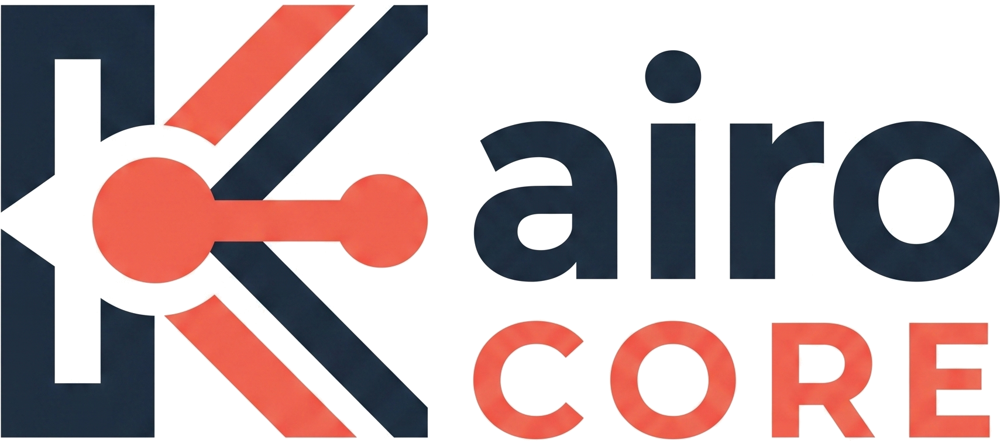

<div align="center">

  

  
  ### **School Central Operation & Resource Environment**

  <p><b>Every tool your school needs.</b> From admissions to analytics, KairoCORE brings the day-to-day running of your school into one connected platform.</p>

  <p>
    <a href="https://kairo.co.zw" target="_blank"></a>
    <a href="https://kairo.co.zw/register" target="_blank"></a>
    <a href="https://kairo.co.zw/contact" target="_blank"></a>
  </p>

  <p>
    
    
    
    
    
  </p>

</div>

---

## 👨‍💻 Architect & Lead Developer
Crafted with precision, architectural rigor, and uncompromising quality by **Tinotenda Hlatywayo**. KairoCORE represents the pinnacle of modern edtech software engineering—combining high-performance backend architecture with a gorgeous, user-centric interface.

---

## 🌟 All Features & Modules

KairoCORE is structured into three powerhouse pillars covering every facet of modern educational institutions:

### 🎓 Academic Excellence
| Module | Description | Key Capabilities |
| :--- | :--- | :--- |
| **Academics** | Comprehensive curriculum & class orchestration | Class management, Timetable scheduling, Report cards |
| **Students** | Empowered student portal & directory | Student portal, Attendance tracking, Student directory |
| **Library** | Intelligent resource & circulation tracking | Book catalogue, Issuance tracking, Returns & fines |
| **Exams & Results** | Rigorous evaluation & result publishing | Exam scheduling, Grade setup, Result publication |
| **LMS** | Modern digital learning environment | Assignments, Course materials, Student submissions |

### 🏛️ Administration & Operations
| Module | Description | Key Capabilities |
| :--- | :--- | :--- |
| **Admissions** | Frictionless enrolment & pipeline vetting | Online applications, Student registration, Admission approval |
| **Finance & Fees** | Robust billing, invoicing & payment tracking | Fee structure, Invoicing, Financial history |
| **HR & Payroll** | Complete staff lifecycle management | Staff records, Leave management, Payroll processing |
| **Inventory & Procurement** | Asset tracking & stock control | Stock management, Requisitions & POs, Asset tracking |
| **Website CMS** | Dynamic content & public web builder | Page management, Media library, Content editor |
| **Reports & Analytics** | Data-driven institutional insights | Financial reports, Academic reports, Custom reports |

### 🌿 Campus Life & Community
| Module | Description | Key Capabilities |
| :--- | :--- | :--- |
| **Attendance** | Real-time presence monitoring | Daily attendance, Attendance reports, Absence alerts |
| **Communications** | Multi-channel instant stakeholder alerts | School announcements, Email/WhatsApp alerts, Parent engagement |
| **Health & Wellness** | Infirmary & medical record tracking | Health records, Clinic visits, Medical alerts |
| **Boarding & Hostel** | Accommodation & dormitory logistics | Room allocation, Hostel attendance, Boarding fees |

---

## 🌍 Multi-Language Support
KairoCORE is engineered for global and regional deployment, featuring built-in **multi-language support** allowing institutions to seamlessly switch interface languages and localize academic nomenclature for diverse student bodies and communities.

---

## 🛠️ Technology Stack

- **Core Framework:** PHP 8.3, Laravel 13 Framework
- **Admin & Control Panels:** Filament v3.2, Livewire, Tailwind CSS
- **Database & Performance:** MySQL / PostgreSQL, Redis Caching
- **Document & Media Engine:** Barryvdh Laravel Dompdf, PhpOffice PhpSpreadsheet, QR & Barcode generators
- **Integrations:** Paynow SDK for seamless fee collections

---

## 🚀 Quick Start & Installation

```bash
# Clone the repository
git clone https://github.com/TinotendaHlatywayo/KairoCORE.git
cd KairoCORE

# Run automated setup (dependencies, environment, migrations & assets)
composer setup

# Boot development environment
composer dev
```

---

## 💡 Not sure where to start?

> **Book a personal demo** and let our specialists show you the modules that matter most to your school.
> 
> 👉 [**Schedule Your Demo Now**](https://kairo.co.zw/register) | 📞 [**Contact Our Team**](https://kairo.co.zw/contact)

---

<div align="center">

### **Explore KairoCORE Live**
[kairo.co.zw](https://kairo.co.zw) • [Register / Demo](https://kairo.co.zw/register) • [Contact Support](https://kairo.co.zw/contact)

<p>Designed & Developed with excellence by <b>Tinotenda Hlatywayo</b></p>

</div>
